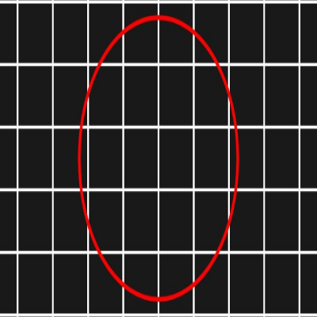
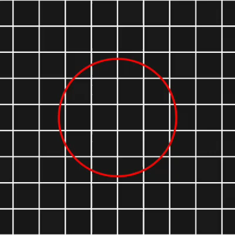

# SceneCam

An OBS-inspired Android scene composer with an LSPosed virtual camera and virtual microphone. Combine visual and audio sources in one app, then expose the result to selected applications through Java camera and audio API hooks.

Current version: **0.9.0**. This is an experimental implementation, not a system Camera HAL or Audio HAL. The Android app currently has a Russian-language interface; this repository's documentation is in English.

## Features

- Layer images, looping local videos, HTTP(S) MJPEG streams, and device cameras.
- Select, drag, and pinch to resize visual sources in the preview; adjust order, opacity, rotation, mirroring, and visibility.
- Configure canvas dimensions, scene FPS, and preview refresh rate independently.
- Choose aspect-preserving fit, center crop, fit with background fill, or intentional stretch, globally or per layer.
- Add multiple camera sources. Duplicate sources using the same camera ID share a connection; concurrent physical cameras still depend on device support.
- Mix four audio source types: device playback, physical microphone, direct internet audio, and looping local audio files. Each source has an enable switch, gain, and level indication.
- Replace supported Java Camera1/Camera2 and AudioRecord paths without opening physical capture devices in the receiving app.
- Configure receiving applications exclusively in LSPosed. There is no second application allowlist inside SceneCam.

## How it works

SceneCam runs a foreground service that composites visual layers into a bitmap and publishes JPEG frames through an Android ContentProvider. Its audio mixer produces a 48 kHz mono PCM16 timeline through the same provider.

The APK also contains an Xposed module. LSPosed loads it into the applications in its scope. The module creates virtual Camera1/Camera2 objects and feeds the composed scene into supported preview surfaces, callbacks, and ImageReaders. Virtual AudioRecord reads the mixed PCM timeline instead of creating an AudioFlinger recording input.

When a scene is unavailable, hooked camera outputs use black frames and virtual audio recording produces silence; supported hooked paths do not fall back to physical capture. This does **not** intercept every native camera/audio API or remove an application's own permission/privacy checks.

Read [Architecture](docs/ARCHITECTURE.md) for the component map, IPC methods, output formats, permission behavior, and the SurfaceTexture aspect-ratio fix.

## Requirements

- Android 9 / API 28 or newer for installation.
- A working Xposed-compatible runtime, normally LSPosed, for substitution in other applications. The standalone composer does not install LSPosed or root the device.
- Compatibility must be checked with your Android version, ROM, LSPosed build, and receiving application. Runtime results in this repository were obtained on an API 37 x86_64 emulator using LSPatch 487, not on a physical system-wide LSPosed installation.

The APK targets API 35 and is compiled against API 36.

## Installation and usage

1. Download the signed APK from [Releases](https://github.com/ssdhdw/SceneCam/releases/latest), or build the app yourself.
2. Enable SceneCam in LSPosed and select the receiving applications in its scope. Do not add the Android framework just to use this app.
3. Open SceneCam and add visual/audio sources. Choose **Crop** or **Fit** to preserve proportions; **Stretch** deliberately changes them.
4. Start the scene and wait for the preview. Physical camera permission is needed only for a visible device-camera source. Physical microphone permission is requested only for an enabled microphone source.
5. Force-stop and reopen the receiving applications after enabling or updating the module. A startup Toast and the connection diagnostics help confirm module loading.
6. Open a supported camera or recording feature in the receiving application.

For device playback capture, the playback-producing application must also be in LSPosed's scope and use Java AudioTrack writes. This source is not a system-wide playback-capture service.

Stop the scene before adding sources or enabling a physical microphone source so the foreground service can start with the appropriate capture type. If system camera/microphone privacy is enabled, use file/network sources rather than expecting the physical source to remain available.

## Local media access and permissions

**While a scene is running, its composed video and mixed audio are accessible to other local applications.** The exported provider is not protected by a private per-client authorization mechanism. SceneCam grants frame URI access to installed packages to establish Android package visibility; this is independent of LSPosed's hook scope. Stopping the service clears the scene, resets audio, and revokes frame URI grants. Do not treat LSPosed scope as a confidentiality boundary for the running media stream.

SceneCam declares CAMERA and RECORD_AUDIO, but requests/uses physical capture only when the corresponding source is enabled. Images, files, internet audio, and hooked Java AudioTrack playback do not require physical microphone permission. Receiving apps may still perform their own permission checks before reaching the hooked APIs.

The app uses INTERNET for network sources and QUERY_ALL_PACKAGES to grant local provider visibility without an additional application selector. HTTP sources are supported, so cleartext traffic is enabled.

## Build from source

Use JDK 17 and Android SDK Platform 36. Configure the SDK through `ANDROID_HOME` or a local, untracked `local.properties` file. Gradle downloads dependencies from Google, Maven Central, and the Xposed API repository.

```powershell
$env:JAVA_HOME = 'C:\path\to\jdk-17'
.\gradlew.bat :app:assembleDebug :app:lintDebug
```

```sh
export JAVA_HOME=/path/to/jdk-17
sh gradlew :app:assembleDebug :app:lintDebug
```

Output: `app/build/outputs/apk/debug/app-debug.apk`. The project uses Gradle 8.11.1 and Android Gradle Plugin 8.10.1. Local SDK/JDK installations, generated builds, credentials, and third-party test APKs are excluded from Git.

## Automated APK builds and releases

[Build APK and publish release](https://github.com/ssdhdw/SceneCam/actions/workflows/apk.yml) builds a signed release APK and runs release lint on every push to `master`, every `v*` tag, and manual dispatch. Ordinary builds are available as Actions artifacts for 30 days. Version tags must match `versionName` in `app/build.gradle`.

To publish, update `versionName` and `versionCode`, then push a tag such as `v0.9.0`. Alternatively, run the workflow manually with **publish** enabled. Successful release runs attach `SceneCam-<version>.apk` and `SHA256SUMS.txt` to GitHub Releases. An existing release is never silently overwritten.

The persistent signing key and passwords are stored in repository Actions secrets: `ANDROID_KEYSTORE_BASE64`, `ANDROID_STORE_PASSWORD`, and `ANDROID_KEY_PASSWORD`; the alias is `scenecam`. They are not committed to the repository. Fork maintainers must supply their own signing secrets before using this workflow. Signing secrets are not exposed through a pull-request workflow.

Release APKs use a different signing certificate from earlier locally built debug APKs. Uninstall the debug build before installing the first release APK; this removes its app data, so record your settings first. Subsequent official releases retain the release signing identity. Local unsigned release builds require the signing environment variables configured in `app/build.gradle` to become installable APKs.

## Validation

See [Validation](VALIDATION.md) for observed results and their limits, and [Probe instructions](test-tools/probe/README.md) for the independent receiving app.

The 0.9 geometry regression uses a square grid, real SurfaceTexture/OES sampling, square cropping, AVC encoding to MP4, and decoding back to an image. Before the fix, cells measured 44.5 x 79 pixels; after the fix, they measured 44.5 x 44.5 pixels, including the decoded video.

| Before | After AVC encoding and decoding |
| --- | --- |
|  |  |

[Test image](docs/runtime-tests/v9-square-grid.png) · [Measurements](docs/runtime-tests/v9-grid-results.txt) · [Test video](docs/runtime-tests/v9-round-grid.mp4)

## Known limitations

- Hooks run inside selected processes. Native NDK camera, AAudio, OpenSL ES, and arbitrary JNI capture paths are not virtualized.
- Camera2 RAW, reprocessing, high-speed/offline sessions, native JPEG/HardwareBuffer access, and the full range of physical multi-camera configurations are unsupported.
- AudioRecord is virtualized; MediaRecorder audio encoding from virtual PCM is not implemented. Its hooked audio prepare/start path is rejected rather than opening the physical microphone.
- Device audio capture covers supported Java AudioTrack PCM writes in scoped apps, not compressed/native playback. Large writes may be truncated by bounded capture packets.
- The audio mix is mono with simple resampling; multichannel virtual reads duplicate the mono signal. Precise audio/video synchronization is not implemented.
- Network video supports MJPEG, not RTSP/RTMP/HLS/SRT. Internet audio must be a direct stream/file supported by Android MediaExtractor/MediaCodec, not a webpage.
- CPU bitmap composition, JPEG IPC, and video extraction are expensive. Actual frame rates depend on the device and source count.
- Some camera implementations use internal framework classes and reflection. ROM/version differences can break compatibility.
- No universal compatibility claim is made for Telegram or any other app. The round-video geometry regression reproduces the relevant graphics path in an independent probe; it is not an authenticated Telegram end-to-end test.

## References

- [android_virtual_cam](https://github.com/w2016561536/android_virtual_cam): reference for the Camera API hook approach. SceneCam uses its own compositor and ContentProvider transport rather than the reference project's file-based video path.
- [LSPosed](https://github.com/LSPosed/LSPosed) and [Xposed API](https://api.xposed.info/reference/).
- [JingMatrix/LSPatch](https://github.com/JingMatrix/LSPatch): emulator-side module-loading tests only; not bundled.
- [Telegram Android](https://github.com/DrKLO/Telegram): InstantCameraView, CameraSession, CameraController, and Camera2Session were studied to investigate round-video geometry. Telegram source code and APKs are not included.
