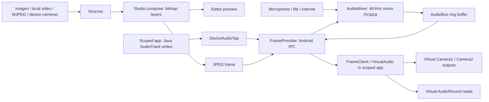

# Architecture

SceneCam packages an Android scene editor and an Xposed module in the same APK. The editor owns sources and composition; the module adapts that output to supported Java capture APIs in other processes.

## Data flow

LSPosed chooses which application processes receive hooks. There is no target-app package check in the virtual device implementation. SceneCam skips its own process and the Android framework process.

## Editor and visual sources

`MainActivity` edits `Studio.layers` and `Studio.audio`. `Studio` persists configuration in SharedPreferences. A visual `Layer` contains a source URI, normalized position/size, visibility, opacity, rotation, mirroring, and a scaling mode. Drag/pinch gestures change the selected layer's transform.

`Sources` reconciles workers as the scene changes. Images are decoded through ContentResolver; local videos use MediaMetadataRetriever; network video reads MJPEG; `CameraSource` uses physical Camera2 YUV ImageReaders. Layers referencing the same physical camera ID share a worker. Different cameras can run together only when the device supports that combination.

`StudioService` runs composition on an adaptive scheduled executor. `Studio.compose()` clips and draws each visible source with its transform. `FrameScale` implements fit, crop, stretch, and fit over background fill. A layer can inherit the global mode or override it. The composed bitmap is used directly for editor preview and encoded as JPEG for IPC. Scene generation FPS and UI refresh FPS are separate limits.

## Provider transport and local access

`FrameProvider` exposes authority `studio.scenecam.frames`:

| Endpoint | Purpose |
| --- | --- |
| Read-only `/frame` | A pipe containing the latest JPEG; unavailable while stopped |
| `call("status")` | Running/frame status, FPS, scale mode, and receiver diagnostics |
| `call("audioPull")` | PCM16 audio at the requested sample rate, with an independent client cursor/generation |
| `call("audioStatus")` | Whether device-playback capture is currently requested |
| `call("audioPush")` | Bounded PCM packets from hooked playback sources |

`SceneAccess` periodically grants `/frame` read access to installed packages. URI grants also establish provider/package visibility on recent Android versions. Updated packages are regranted access. Service shutdown revokes these grants.

The provider is exported without a signature permission or private allowlist. The running scene is intentionally available to local applications, including ones outside the hook scope; PCM playback injection is accepted when the device source is enabled. This is a media-sharing design, not an authenticated IPC boundary. Frame grants are not a general authorization layer for provider `call()` methods. Stopping the service clears video, resets the audio timeline and playback streams, and closes physical source workers.

## Virtual camera

`CameraHook` installs hooks in scoped processes and connects lazily after Application attachment. `FrameClient` fetches the current JPEG/status in the background, maintains frame freshness, and scales/converts output to requested sizes.

`VirtualCamera` intercepts Camera1 `open`/`openLegacy` and Camera2 `CameraManager.openCamera`. Virtual Java objects are allocated without native device setup. Their methods dispatch to module-owned state instead of opening a hardware camera. Camera1 direct native construction is rejected in the scoped process. Missing scene frames produce black output.

Camera1 supports preview Surface/SurfaceTexture, parameters, normal/one-shot/buffer NV21 callbacks, autofocus callbacks, and JPEG pictures. Callbacks are posted to the opening thread's Looper. Camera2 supports regular sessions, common configuration overloads, Handler/Executor callbacks, capture/burst/repeating requests, and synthesized capture metadata. Closed objects remain marked as retired so later method calls cannot fall through into native device behavior.

`VirtualOutput` draws into ordinary Surfaces or fills YUV_420_888 ImageReader buffers through ImageWriter. `VirtualJpeg` supplies Java-visible JPEG ImageReader images. Internal Android framework types used by this path are version-sensitive.

### Why round-video preview used to stretch

Telegram's `InstantCameraView` receives camera frames as external OES textures, uses the SurfaceTexture transform, and crops texture coordinates before drawing and encoding a square video. Camera1 `CameraSession` supplies display orientation. Camera2 follows its own raw-sensor orientation path.

The previous Camera1 implementation ignored `setDisplayOrientation()`. Correct NV21 callback images did not prove that the oriented texture path was correct. The receiving renderer cropped a landscape buffer as though it had already been oriented, changing square grid cells into rectangles.

Version 0.9 publishes an already oriented Canvas-produced preview buffer: for example, 640 x 480 raw preview parameters with a 90-degree display orientation use a 480 x 640 SurfaceTexture buffer. Geometry is refreshed on texture binding, parameter changes, orientation changes, and preview start. The scene represents the upright composed preview. Raw NV21 callback and picture dimensions remain those requested in Camera.Parameters.

This implements the required geometry without depending on Telegram's package or modifying its renderer. It is not a reproduction of every native HAL transform/mirroring metadata detail. See [the measured regression](../VALIDATION.md).

## Audio mixer and virtual microphone

`AudioMixer` processes 960-sample blocks at 48 kHz (20 ms). Enabled sources supply PCM through bounded `PcmPipe` queues. File/internet workers use MediaExtractor and MediaCodec, downmix channels, and resample. Local files loop; network sources reconnect after errors/end-of-stream. The physical microphone worker is the only source that creates a real AudioRecord.

The mixer applies each source's gain, updates levels, sums sources, and clips to PCM16. `AudioBus` keeps a two-second mono ring buffer. Independent receiver cursors prevent one virtual recording client from consuming another client's samples. Device-playback streams use bounded queues and inactive-stream expiration.

`VirtualAudio` replaces AudioRecord native setup/control/read paths. It serves samples through `audioPull`, converts sample rate/representation, duplicates mono into requested channels, tracks recording state/timestamps, and paces blocking reads. Supported reads include byte[], short[], float[], and direct ByteBuffer. There is no physical recording fallback when the scene stops.

`DeviceAudioTap` copies successful Java AudioTrack PCM writes in scoped apps, converts them to PCM16, and sends bounded packets on a background worker. Nested write overloads are deduplicated. SceneCam itself is excluded to avoid self-capture recursion. This is not Android PlaybackCapture/MediaProjection and does not capture arbitrary system output.

MediaRecorder audio is not encoded from this PCM timeline; the hooked audio prepare/start path is explicitly rejected. Native AAudio/OpenSL ES/JNI recording is outside the implementation.

## Capture permissions and lifecycle

- A visible physical camera layer requires CAMERA; virtual/file/network visual sources do not open that camera.
- An enabled physical microphone source requires RECORD_AUDIO. Without that source, SceneCam does not request microphone access or create a physical microphone AudioRecord.
- On modern Android, the foreground service adds camera/microphone types only for the corresponding enabled source with permission. The service otherwise uses its special-use type.
- Receiving applications may independently require permissions or inspect sensor privacy before reaching a hook; SceneCam does not rewrite those application checks.
- Shutdown stops the mixer/compositor, closes source workers, clears current frames/audio, and revokes frame URI grants.

## Implementation boundaries

This is process-local Java API virtualization. It does not register a new system camera/microphone, replace a HAL, or intercept every native path. Metadata enumeration can still query CameraService, although virtual capture avoids opening a physical device. JPEG/internal framework compatibility, concurrent cameras, Surface ownership, CPU/JPEG costs, and audio/video synchronization remain practical limits.
